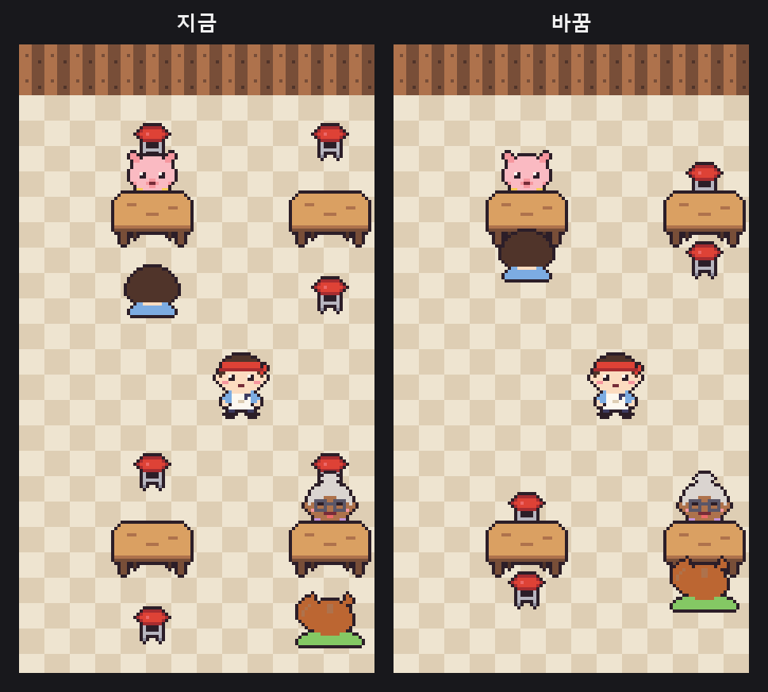

# 설계: 분식집 테이블 자리 — 의자를 테이블에 붙이고 손님을 의자에 앉히기

상태: 제안 (컨펌 대기)

장사 화면에서 손님은 테이블에 붙어 앉는데 의자는 따로 떨어져 있어, 의자가 왜 있는지 알 수 없다.
의자를 테이블 위아래에 붙이고, 손님은 그 의자에 앉힌다. 걷는 규칙은 그대로 두고 **그림 자리만** 바꾼다.

---

## 1. 지금

- 걷는 규칙: 테이블 줄(x = 1·3·5)의 의자 칸(y = 0·2·4·6)은 손님 자리라 못 지나가고, 가운데 줄(y = 3)로만 가로지른다([분식집 설계 §4](./261022-09-snack-bar.md), `logic/grid.ts`의 `isWalkable`). **이 규칙은 바꾸지 않는다.**
- 그림
  - 의자가 칸 가운데쯤에 있어 테이블과 의자 사이에 바닥이 35px쯤 보인다.
  - 위쪽 손님(앞모습)은 의자에 앉지 않고 테이블 위 가장자리에 붙어 있다. 의자는 손님 머리 위로 삐져나와 말풍선 꼬리와 머리 사이에 보인다.
  - 아래쪽 손님(뒷모습)은 한 칸 아래 의자에 앉아 테이블과 떨어져 있다.

시안: 가로 배치(칸 112 × 104px), 게임 도트 그림 그대로 합성. 왼쪽 위·오른쪽 아래 테이블은 손님 두 명, 나머지는 빈 테이블이다. 가운데는 통로 줄(y = 3)에 선 직원.

---

## 2. 바꾸는 것

테이블 자리는 그대로(아래 끝 = 칸 가운데 + 0.35 × 칸 높이). 의자·손님을 **테이블 위·아래 끝 기준**으로 놓는다. 숫자는 1배 px이고 가로·세로 배치에 같이 쓴다.

| 그림 | 지금 (아래 끝) | 바꿈 |
|---|---|---|
| 위 의자 | 위 칸 가운데 + 0.3 × 칸 높이 | 아래 끝 = 테이블 위 끝 + 12px. 아래 12px는 테이블 뒤에 숨고, 손님이 앉으면 손님이 다 가린다 |
| 아래 의자 | 아래 칸 가운데 + 0.15 × 칸 높이 | 위 끝 = 테이블 아래 끝 - 8px. 테이블 다리 앞에 겹친다 |
| 위 손님(앞모습) | 칸 가운데 - 0.18 × 칸 높이 | 그대로 (위 의자를 가리고 테이블 뒤에 앉은 모습) |
| 아래 손님(뒷모습) | 아래 칸 가운데 + 0.2 × 칸 높이 | 아래 끝 = 아래 의자 아래 끝 + 4px. 머리가 테이블 아래쪽을 가리지만 테이블 위 접시는 가리지 않는다 |

- 앞뒤 순서: 위 의자 < 테이블 < 위 손님은 지금과 같다. 아래 의자·아래 손님은 테이블 앞(아래 의자 < 아래 손님).
- 비어 있으면 의자 두 개가 테이블 위아래에 붙어 보이고, 손님이 오면 둘 다 의자에 앉아 테이블에 붙는다.
- 손님 그림 자리를 따라가는 연출(나타나기, 거절 때 흔들기, 화나서·다 먹고 나가는 그림)은 그대로 따라 옮겨진다.
- 말풍선 자리는 그대로(꼬리 끝이 위 손님 머리 위). 꼬리와 머리 사이에 보이던 의자가 사라진다.
- 누르기도 그대로: 의자 칸을 눌러도 그 테이블로 친다. 바라보는 노란 테두리도 테이블 칸 그대로.

---

## 3. 바꾸지 않는 것

- 로직(격자·통로·길찾기·손님 규칙), 흉내 플레이어와 밸런스, 서버 검증.
- 테이블·의자·손님 도트 그림 자체, 바닥, 게임 방법 글.

---

## 4. 바뀌는 곳

| 위치 | 변경 |
|---|---|
| `games/snack-bar/src/scene/DayView.ts` | `buildTable`의 의자·손님 자리와 앞뒤 순서 |
| `docs/spec/snack-bar.md` | 장사 화면의 손님·의자 자리 |
